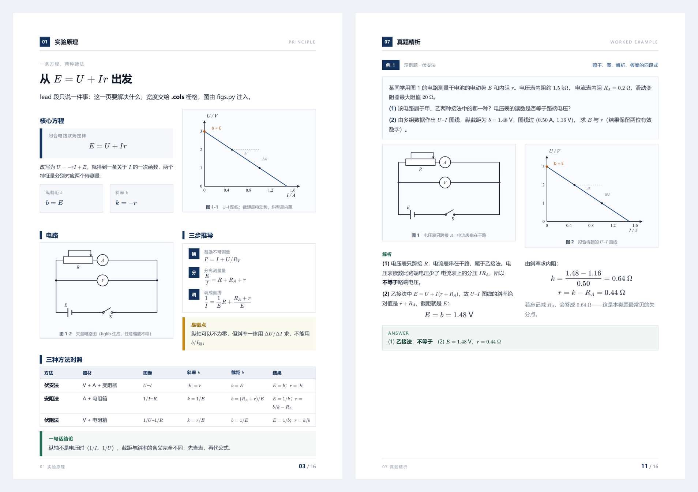

# pptx-to-handout

> Turn a lecture deck (PPT/PPTX 课件) into a **print-ready A4 handout** — HTML/CSS + KaTeX + vector SVG figures, rendered to PDF by headless Chrome.



Most courseware is built for a projector: one idea per slide, formulas pasted as OLE
objects, arrows and red answers scrawled on top. Printed as-is, it wastes paper and
reads badly. This toolkit treats the deck as a **content source**, re-authors it into a
proper document, and ships a build + QA pipeline that guarantees the result fits A4.

---

## What's inside

| | |
|---|---|
| **Recon** | `extract_pptx.py` dumps the shape tree, text, tables and images; `render_pptx.py` converts the deck with LibreOffice and renders every slide to PNG so you can actually read formulas that only exist as pictures. |
| **Authoring** | One HTML file per page (`handout/parts/p01.html …`), a component CSS system (`assets/base.css`), math as `$…$` / `$$…$$`. |
| **Figures** | `scripts/figlib.py` — a small SVG kit for circuits (`wire`, `resistor`, `rheostat`, `meter`, `battery`, `switch`) and data plots (`Chart` with axes, grid, slope triangle, annotations). Crisp at any print size, no screenshots. |
| **Build** | `build.py` joins the parts, injects figures, pre-renders KaTeX in Node, prints with Chrome `--headless=new`. |
| **QA** | `qa_check.py` checks content overflow per page, A4 page geometry, CJK font embedding (flags Type3), and renders page PNGs for visual review. |
| **Docs** | `SKILL.md` (workflow + quality gates), `references/workflow.md` (runbook), `references/pitfalls.md` (17 real traps), `references/design-system.md` (grid, type, components). |

## Quick start

Requirements: Python 3.9+, Node 16+, [LibreOffice](https://www.libreoffice.org/),
Chrome or Edge.

```bash
git clone https://github.com/atqiyu/pptx-to-handout.git
cd pptx-to-handout
pip install -r requirements.txt

# 1. look at the deck
python scripts/extract_pptx.py  deck.pptx work/
python scripts/render_pptx.py   deck.pptx work/render --dpi 150

# 2. build a handout from parts
mkdir -p handout/parts
cp assets/examples/part-example.html      handout/parts/p01.html
cp assets/examples/part-example-2.html    handout/parts/p02.html
cp assets/examples/figs-example.py        handout/figs.py
python scripts/build.py --dir handout --out out/handout.pdf --title "Demo"

# 3. gate the result
python scripts/qa_check.py handout --pdf out/handout.pdf --dpi 150
```

The two example pages above are what you see in the preview image.

## Workflow

| # | Phase | Gate |
|---|-------|------|
| 0 | **Recon** — extract + render + read every slide | you can describe each slide without looking |
| 1 | **Audit** — content inventory + defect list | every typo, wrong label and unverified answer is written down |
| 2 | **Architect** — A4 page map | one claim per page; examples last |
| 3 | **Design** — tokens, components, grid | one page composed and approved before mass production |
| 4 | **Figures** — vector first | every figure legible at its printed size |
| 5 | **Build** | 14–18 pages, A4, no raw LaTeX |
| 6 | **QA** — overflow / geometry / fonts / eyes | zero overflow, searchable text |
| 7 | **Deliver** | PDF next to the source, source tree kept |

Rule of thumb: a 20-slide deck becomes **14–18 A4 pages**, not 20.

## Repo layout

```
pptx-to-handout/
├── SKILL.md                     # agent-facing workflow + quality bar
├── references/
│   ├── workflow.md              # phase-by-phase runbook, audit templates
│   ├── pitfalls.md              # traps + fixes (SVG vanishing, Type3 fonts, …)
│   └── design-system.md         # A4 grid, colour, type, components
├── scripts/
│   ├── extract_pptx.py          # python-pptx structure dump
│   ├── render_pptx.py           # LibreOffice → PDF → page PNGs
│   ├── build.py                 # parts → HTML → KaTeX → PDF
│   ├── math.js                  # server-side KaTeX pre-render
│   ├── qa_check.py              # overflow / A4 / fonts / renders
│   └── figlib.py                # SVG circuit + chart primitives
├── assets/
│   ├── base.css                 # the design system
│   ├── katex/                   # local KaTeX + woff2 (works offline)
│   └── examples/                # two demo pages + a figure module
└── docs/preview.png
```

## As a ZCode skill

The repo **is** the skill. Copy (or symlink) it into a skills directory:

```bash
# user scope
cp -r pptx-to-handout ~/.agents/skills/
# or project scope
cp -r pptx-to-handout .zcode/skills/
```

Then ask your agent to “把这个课件重排成讲义 / 转成 PDF” and it will follow
`SKILL.md`. The `description` field in the frontmatter is tuned to trigger on
phrasings like *重新排版*, *做成讲义*, *转成 PDF*, *make a printable handout*.

## Notes & limits

- **CJK-first.** The default type stack starts with Microsoft YaHei because
  Chrome vectorises OTF/CFF CJK fonts into Type3 (unsearchable, huge files).
  For other scripts, change the stack in `assets/base.css`.
- **A4 portrait only.** US Letter needs a page-size change in `base.css` and
  in the `qa_check` tolerance.
- The QA script assumes the page skeleton from `base.css`
  (`.page > .content` + `.runfoot`). If you rename those, update the checks.
- Figures are code, not assets: expect to write ~5 lines of Python per circuit.

## 中文速览

**做什么**：把讲课用的 PPT 课件重新写成一份 A4 讲义（HTML + KaTeX + 矢量图），再用
Chrome 打成 PDF，并自动检查溢出、页面尺寸与中文字体嵌入。

**为什么**：课件是一页一个点、公式是截图、答案直接涂在题上；照原样打印既费纸又难读。
这个工具把课件当**素材**，按“原理 → 电路 → 误差 → 改进 → 方法 → 例题”重写，
21 页 PPT 通常变成 14–18 页讲义。

**怎么用**：见上方 Quick start 三条命令；页面内容就是 `handout/parts/*.html`，
一页一个文件，改哪页动哪页；图由 `figs.py` 生成，`{{FIG:name}}` 注入。

**质量闸门**：`qa_check.py` 会报出“第 N 页溢出多少像素”、非 A4 页面、Type3 字体；
最后把每页渲染成 PNG 供逐页目视。

## License

MIT — see [LICENSE](LICENSE).